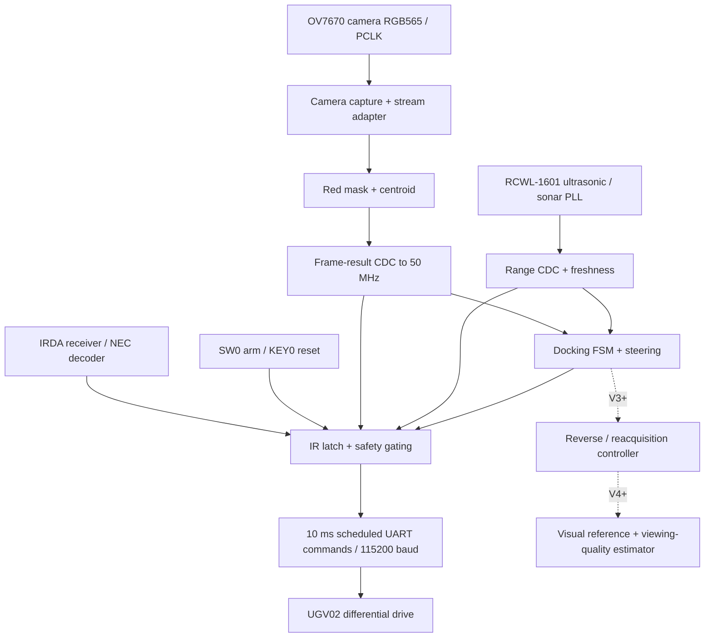

# MTRX3700 Major Project — FPGA Autonomous Precision Docking

**Group 26 | University of Sydney | Semester 2, 2026**  
**README revision:** `0.2.2` — 24 October 2026  
**RTL baseline:** V1 simulated, commit [`b1b4645`](https://github.com/jyan6400/MTRX3700-Major-Project/commit/b1b4645)  
**Current priority:** V1 FPGA/hardware bring-up and V2 independent RTL development  
**Target milestone:** V4 HD-candidate demonstration; V5 is optional and must not jeopardise V4.

> **Living specification.** This README describes the current implemented baseline and *proposed* V2–V5 work. Subsequent rungs, interfaces, assignments and test targets may change as hardware feasibility and verification results become known. Review and increment the README revision after **every version's testing/verification stage**; record decisions in the revision log at the bottom. A proposed feature is not evidence that it is implemented, synthesised or physically demonstrated.

## 1. Project overview and engineering narrative

Our project is an **airport-inspired autonomous precision-docking system**, demonstrated at model scale using a DE1-SoC-controlled UGV02 differential-drive robot. The robot detects an illuminated docking marker using an OV7670 camera, estimates its horizontal alignment from FPGA-processed pixels, steers toward the designated bay and uses forward-facing ultrasonic ranging to halt at a controlled stand-off distance.

The airport context provides a practical engineering narrative: visual docking guidance, alignment with a designated bay, approach speed control, repeatability, operational supervision and fail-safe stopping. **This is a scale-model demonstration, not a full aircraft docking, localization or collision-avoidance system.** We deliberately avoid requiring 3D pose estimation, SLAM or unvalidated visual odometry on the critical path.

The project develops cumulatively:

- **V1 — Single-bay docking:** acquire one red marker, align, approach and stop.
- **V2 — Robust docking:** suppress visual/range noise, improve detection reliability and smooth motion.
- **V3 — Repeated multi-bay docking:** dock, make a bounded retreat, reacquire the next illuminated bay and repeat.
- **V4 — Visibility-aware repositioning (HD candidate):** improve the return-to-viewing-position behaviour using actual visual feedback, and compare against V3's timed baseline.
- **V5 — Optional extension:** detect a target switching/disappearing during operation and safely stop, replan and reacquire.

The three illuminated bays form an airport-inspired **dynamic bay-assignment demonstration**, not a separate unrelated game. Optional target selection/LED switching hardware may be used only as an approved peripheral; the FPGA must retain camera processing, navigation decisions and motor safety.

### Preliminary performance goals (not yet achieved)

| Metric | Preliminary goal | Earlier threshold | Measurement required |
|---|---:|---:|---|
| Docking position error | ≤30 mm | ≤75 mm | Physical trials with a defined reference position |
| Camera-to-UART processing latency | ≤75 ms | ≤150 ms | Real sensor event to relevant complete UART command |
| Docking repeatability | ≤40 mm | ≤100 mm | Repeated physical trials under controlled start conditions |

Targets may be refined with tutor approval and documented experimental evidence. Do not confuse the **8.826 ms simulated stop-event-to-UART-message observation** with full camera-to-actuation latency or physical stopping distance.

## 2. Actual V1 implementation status (24 October)

**Committed:** `rtl/`, `sim/`, `vendor/` and `.gitignore` in `b1b4645` on `main`.

| Area | V1 implementation | Verification status |
|---|---|---|
| Camera | OV7670 configuration/capture; RGB565 pixel stream with coordinates | Component and simulation integration tests |
| Vision | Red threshold/mask, red-region centroid and frame-level result CDC | Unit/integration simulation |
| Navigation | Acquire → approach → docked FSM; centroid-based steering | Unit/integration simulation |
| Sonar | RCWL-1601 echo ranging, CDC, age/range validation | Unit/integration simulation |
| Safety | SW0 arming; latched NEC IR emergency stop; camera/sonar freshness gating | Safety simulation |
| Chassis | Signed left/right motor requests encoded as 115200-baud UART commands, 10 ms command scheduling | End-to-end UART simulation |
| System | `major_project_top.sv` integration | Top-level simulated, no physical evidence yet |

**Current simulation evidence:** 231/231 accumulated numbered RTL checks passed, including the four stop-latency checks at 10 ms UART scheduling. The testbench observed **8.826 ms** from its injected IR-stop or 250 mm docking-stop event to a decoded stop UART message. This is a test-specific observation, not a proven worst-case hardware limit. Vendor camera and sonar example regressions were also exercised separately.

**Not yet verified:** integrated Quartus synthesis and timing closure; correct combined GPIO/electrical wiring; real camera-to-wheel control; real ultrasonic calibration; actual physical emergency stop and stopping distance; repeated bay switching, reverse/reacquisition, bypass comparisons and HD-level novelty.

### Safety and V1 limitations

- KEY0: active-low reset; SW0: arm enable. IR Power latches emergency stop; IR CH+ releases the latch. Start with wheels raised and a separate physical means of cutting motor power.
- Nominal docking stop threshold is **250 mm** of forward-facing ultrasonic distance. The ultrasonic sensor does **not** protect the rear of the robot during reversing.
- Loss of fresh target frames or valid sonar inhibits drive commands. UART zero-PWM messages are **not an instantaneous motor power cut**.
- V1 contains only **single-target docking**. `docking_fsm.sv` presently has `IDLE`, `ACQUIRE`, `APPROACH`, `DOCKED`, `STOPPED` states. A reverse/reacquisition state machine is future V3 work.
- The 10 ms UART command period is implemented in `rtl/integration/major_project_top.sv` and tested in `sim/integration/top_uart_latency_tb.sv`.

## 3. System architecture



### Clock and interface domains

| Domain | Clock | Main function | Crossing requirement |
|---|---|---|---|
| Navigation / IR / UART | `CLOCK_50` (50 MHz) | Safety, control FSM, chassis commands | Receives synchronised sensor results |
| OV7670 pixel capture | Camera `PCLK` | Pixels, red segmentation, centroid | `vision_result_cdc.sv` request/ack handshake |
| Sonar ranging | Sonar PLL ≈43.904 MHz | Trigger and echo timing | `sonar_result_cdc.sv` handshake |
| OV7670 configuration | Divided 25 MHz camera PLL clock | SCCB camera register configuration | Status synchronisation to 50 MHz |
| OV7670 master clock | 10 MHz camera PLL output | Camera XCLK | GPIO output |

**Hardware pin conventions currently encoded in `major_project_top.sv`:** OV7670 uses GPIO_1[10:25]; sonar trigger GPIO_1[27], echo GPIO_1[29]; chassis TX GPIO_1[31]; DE1-SoC onboard IRDA_RXD; KEY0 and SW0. These are **RTL logical port mappings**; Quartus package pin constraints and electrical compatibility must be checked independently before programming hardware.

## 4. Five-person RTL ownership and interfaces

The five development responsibilities follow the **functional RTL boundaries already used in this repository**, rather than assigning Wilson unrelated game orchestration. **Luke owns camera acquisition; Wilson owns image processing; Marcus owns perception; Jason owns navigation and docking orchestration; Advay owns actuation, ranging and safety.** Existing `rtl/` subdirectories are functional categories, not proof of historical individual authorship. Changes to actual file ownership must be agreed and recorded in `OWNERS.md`.

| Workstream / owner | Current RTL directory and V1 starting points | Proposed new V2–V5 contributions | Primary verification |
|---|---|---|---|
| **M1 — Luke: camera capture & stream interface** | `rtl/integration/camera_stream_adapter.sv`; `vendor/camera/rtl/ov7670_capture.sv`, `ov7670_config.sv` | Capture timing/validity, stream-format alignment, frame-loss handling and acquisition reliability; coordinate upstream camera configuration | Camera timing, pixel positions, frame boundaries, reset and frame-loss tests |
| **M2 — Wilson: image processing** | `rtl/image_processing/red_mask.sv` | Streaming spatial filtering/denoising, red-pixel classification improvements, lighting robustness, and V4 reference-marker feature preprocessing | Image input → filtered/masked output, pixel alignment, false-colour cases, edges and latency |
| **M3 — Marcus: perception & tracking** | `rtl/perception/led_centroid.sv`; collaborate on `vision_result_cdc.sv` integration | Object/blob validity, frame-level centroid/target confidence, temporal tracking, multi-reference visibility estimator and target-change recognition | Centroid/feature golden model, false target, target loss, marker visibility and tracking tests |
| **M4 — Jason: navigation, docking & bay sequencing** | `rtl/navigation/docking_fsm.sv`, `steering_controller.sv`, `camera_frame_watchdog.sv`; `rtl/actuation/motion_interface.sv` is a cross-boundary navigation integration file | Steering/speed tuning; dock → reverse → reacquire cycle; internal bay-selection/game FSM and V4 visibility-aware return with V3 bypass; optional V5 replanning | Motion/FSM tests, multi-cycle docking, steering and visual-return comparison |
| **M5 — Advay: sensors, safety & chassis actuation** | `rtl/actuation/ir_safety_latch.sv`, `sonar_freshness.sv`, `rtl/integration/sonar_result_cdc.sv`; `vendor/chassis/rtl/chassis_drive.sv` | Range filtering, forward/reverse motion guards, emergency-stop arbitration, command watchdog/priority, optional approved LED control signalling | No-echo, stale-range, IR stop, reverse hazards, zero-command and UART timing tests |

**Integration ownership:** Jason coordinates `rtl/integration/major_project_top.sv`, but each member must verify their own path into the top-level. For the game/three-bay functionality, **Jason owns the FPGA navigation/selection state machine**, Marcus owns perceived target identity, and Advay owns any approved electrical/communication interface for external lights. This avoids an artificial sixth workstream or assigning image-processing work away from Wilson.

**Original V1 provenance:** This table allocates review and future development; it does **not** retrospectively claim each person authored the current V1 files. Record source, original/new or adapted status, responsible student, own RTL/TB and reviewer in `OWNERS.md`, distinguishing vendor/course RTL from original contributions.

### Functional pipeline and workstream hand-offs

```text
 OV7670 / PCLK
     |
     v
 [Luke: camera capture + RGB565 frame/pixel-valid stream]
     |
     v
 [Wilson: image filtering + colour/marker feature mask]
     |
     v
 [Marcus: centroid, tracking, target confidence, visibility]
     |  frame-level result + safe CDC to 50 MHz
     v
 [Jason: docking FSM, steering, bay selection and reposition]
     |  signed left/right requests + mode
     v
 [Advay: range/IR supervision, final motor gating + chassis UART] ---> UGV02
     ^
     +------- RCWL-1601 sonar / IR / safety inputs
```

| Producer → consumer | Required V2 contract | Planned V3–V5 additions |
|---|---|---|
| Luke → Wilson | RGB565, `pixel_x/y`, `pixel_valid`, `frame_start/end`, PCLK timing | Image quality/frame-validity markers |
| Wilson → Marcus | Aligned pixel coordinates, valid, red/feature mask, optional filtering latency | Persistent marker/reference feature stream |
| Marcus → Jason | Atomic frame event, `target_valid`, `target_x`, optional confidence | Target ID, track age, viewing-zone/quality metric |
| Advay → Jason | `sonar_valid`, `distance_mm`, `emergency_stop`, command permission | Reverse limit, fault flags, peripheral status |
| Jason → Advay | Signed left/right wheel demand, enable/stop requests | Reverse mode, selected bay and approved LED-output command |
| Jason ↔ Marcus | Current target selection and observed target location | Bay selection/identity consistency and target re-acquisition |

**Important:** These are workstream contracts to finalise before V2 integration—not a claim that all the proposed ports exist in V1. Existing CDC and safety paths must remain intact. Agree exact signal widths, handshakes, latency and clock-domain ownership before adding ports.

## 5. Version rung requirements (cumulative)

Each cell describes **new expected RTL work or maintenance of that module's interface** beyond the previous rung. The engineering progression remains airport-inspired precision docking, with a three-bay demonstration. Every member is expected to implement and unit-test a substantive synthesizable contribution in V2–V4; requirements may be revised after actual integration/hardware testing and documented in the revision log.

| Rung / outcome | **Luke — Camera** | **Wilson — Image processing** | **Marcus — Perception** | **Jason — Navigation & bay FSM** | **Advay — Actuation & safety** |
|---|---|---|---|---|---|
| **V1 — Single-bay approach (simulated baseline)** | OV7670 acquisition and aligned RGB565 pixel stream | Fixed red-colour mask | Frame-based red centroid and validity | Acquire → approach → dock; centroid steering and 250 mm target stop | Sonar validity, latched IR stop, final motor gating and 10 ms UART |
| **V2 — Robust docking (RTL Sunday 25 Oct, 22:00)** | Validate stream timing; handle malformed/missing frames without corrupting downstream results | **Own streaming filter** (e.g. 3×3 noise suppression or pixel-neighbour consensus) and tuned colour mask while preserving coordinate/valid alignment | Target area/shape/confidence gate and distractor rejection; consume Wilson's output | Bounded steering, deadband/speed scheduling and alignment-aware approach | Range deglitch/filter or confidence and stale-measurement handling; repeat stop-latency/fault tests |
| **V3 — Repeated multi-bay docking (RTL Tuesday 27 Oct, 11:00)** | Camera reliability during movement, frame dropout recovery | Stable red/feature segmentation as distance/exposure changes; prevent filter startup artefacts | Multi-frame confirmation, stale-track invalidation, next-target reacquisition | **Dock → bounded timed reverse → reacquire → dock**; own bay-selection/LED-event sequencing FSM (manual-light fallback if external controller unavailable) | Safe bounded reverse supervision, IR stop in every state, optional LED peripheral signalling |
| **V4 — Visibility-aware repositioning (HD candidate; RTL Wednesday 28 Oct, 18:00)** | Stable reference-frame acquisition and streaming interface under retreat | **Extract persistent reference-marker features** / viewing-zone cues without a frame buffer where practical | Combine features into a **quantitative viewing-quality/visibility metric**, with stability/confidence tests | **Use visual feedback to end/correct retreat**, with a working selectable V3 timed-reverse bypass | Enforce reverse limits and stop priority in both V3/V4 modes; validate actuator/IR/range fault behaviour |
| **V5 — Dynamic bay reassignment (optional, only after V4 stability)** | Robust frame-validity across target-light changes | Handle abrupt lighting changes; preserve classification and feature validity | Detect lost/switched active target and clear obsolete observations | Controlled stop, select new bay, replan and resume only on confirmed target | Peripheral link/ACK timeout and disconnect fail-safe **if approved hardware supports it** |

**V4 is an HD candidate, not a guaranteed grade.** The team must demonstrate a meaningful custom capability, genuine operating baseline/bypass, quantitative improvement and physical evidence. **V5 is optional** and must never destabilise the verified V4 design. In all reverse trials, the front-facing sonar does not provide rear obstacle coverage; use a supervised, physically cleared bounded area.

### Rung evidence and reason for progression

| Rung | Baseline limitation addressed | Minimum evidence for advancement |
|---|---|---|
| V1 | No proven real-world autonomous docking | Live camera-derived guidance and safe 250 mm stand-off in physical trials; actual E-stop measured |
| V2 | RGB false positives, noisy centroids, inconsistent steering/ranging | Paired V1/V2 trials with distractors/lighting variation; detection errors and docking error recorded |
| V3 | V2 ends after one dock and cannot reach a new target | Multiple full bay cycles; reacquisition rate/time; reverse safety/failure cases |
| **V4** | Fixed-time reverse misses a consistent useful viewing location | **Paired V3 bypass vs V4 trials** with heading/start variation; material improvement in reacquisition/viewing-zone repeatability, all critical safety gates unchanged |
| V5 | Dynamic target switching can invalidate navigation | Induced target loss/switch, measurable safe stop and correct new-target acquisition; no regression of V4 |

**HD claim caution:** V4 is a *candidate* because it targets a genuine new feedback capability and supports a physical bypass comparison. A binary marker-visible flag alone is not assumed to meet the HD standard. Final grading depends on implementation sophistication, originality, measurable improvement, individual explanation and actual hardware evidence.

## 6. Next-week schedule (Sydney time, current plan)

| Date / deadline | Milestone | Required deliverable | Status |
|---|---|---|---|
| **Sat 24 Oct, target 19:00–21:00** | V1 testing and verification | Quartus bring-up/timing, physical camera/sonar/IR/UART checks and evidence; **target, not yet complete** | Pending |
| **Sun 25 Oct, 22:00** | **V2 RTL complete and simulated — every member** | Individual RTL + self-checking TB; changed interfaces documented; commit/PR available | Planned |
| **Mon 26 Oct** | **V2 testing and verification** | Integrated regression, board tests, V1/V2 comparison, documented issues | Planned |
| **Tue 27 Oct, 11:00** | **V3 RTL complete and simulated — every member** | Multi-bay/reverse/reacquisition modules and tests; branch or PR ready | Planned |
| **Tue 27 Oct night / Wed 28 Oct** | **V3 testing and verification** | Integrated FPGA tests, multi-cycle trials, safe bounded reverse and reacquisition evidence | Planned |
| **Wed 28 Oct, 18:00** | **V4 RTL complete and simulated — every member** | Visibility-aware feedback, V3 bypass, self-checking TB and integration-ready changes | Planned |
| **Thu 29 Oct onward** | V4 integration, hardware evaluation and optional V5 go/no-go | Timing, paired comparison, acceptance trials; V5 only if V4 is stable | Provisional |

The **V3 testing window overlaps the V4 RTL deadline**. Owners can work on separate feature branches in parallel; merging V4 into the integrated branch remains conditional on successful V3 verification. Do not report V4 as hardware verified by its RTL deadline. If V1 hardware verification slips, prioritise safe core bring-up and record the schedule impact rather than relabelling simulation as hardware evidence.

### What “done” means

- **RTL done and simulated:** synthesizable source committed to a branch, self-checking unit bench PASS, known clock/reset and ports documented, reviewer identified. Each owner reports files, test command, expected outputs and limitations.
- **Integrated simulation:** top-level compiled and realistic inter-module data paths exercised; system safety and fault tests pass.
- **Hardware verified:** Quartus programming/timing understood, real sensors and motor path tested, stop controls demonstrated, quantitative trials/logs recorded. A single successful motion is not sufficient evidence of a full rung.
- **Rung released:** known-good Git commit/tag, updated README revision, module ownership records, evidence links and outstanding risks.

## 7. Repository layout (current, not hypothetical)

```text
MTRX3700-Major-Project/
├── README.md                       # living specification (this file)
├── .gitignore
├── rtl/
│   ├── actuation/                  # IR safety, sonar freshness, motor requests
│   ├── image_processing/           # red_mask.sv
│   ├── integration/                # major_project_top.sv, CDC and adapters
│   ├── navigation/                 # docking FSM, steering, camera watchdog
│   └── perception/                 # led_centroid.sv
├── sim/
│   ├── unit/                       # self-checking module tests
│   └── integration/                # camera/sonar/UART/top-level tests
├── vendor/
│   ├── camera/                     # Ed camera RTL, models and example Quartus
│   ├── ultrasonic/                 # Ed sonar RTL, models and example Quartus
│   ├── ir/                         # Ed NEC decoding reference
│   └── chassis/                    # Ed UGV02 UART/drive RTL
└── build/                          # locally generated; gitignored
```

**Important:** `vendor/*/quartus/*.qsf` are reference/example projects, not a single verified pin/timing constraint file for `major_project_top`. The integrated project's Quartus configuration must still be created and checked. Future folders such as `docs/`, `quartus/`, `scripts/`, `data/` and `golden/` should be added only when they contain real files.

## 8. How to run V1 verification

Developed with **Verilator 5.050** in WSL. Run from the repository root. Simulation outputs are gitignored.

The following reproduces the **four-check UART stop-latency bench** with the current 10 ms UART period:

```bash
cd /mnt/c/mtrx3700_work/MTRX3700-Major-Project
verilator --binary --timing -Wno-CASEINCOMPLETE \
  --top-module top_uart_latency_tb \
  --Mdir build/v1/top_uart_latency \
  rtl/integration/major_project_top.sv \
  rtl/integration/camera_stream_adapter.sv \
  rtl/integration/vision_result_cdc.sv \
  rtl/integration/sonar_result_cdc.sv \
  rtl/image_processing/red_mask.sv \
  rtl/perception/led_centroid.sv \
  rtl/navigation/camera_frame_watchdog.sv \
  rtl/navigation/steering_controller.sv \
  rtl/navigation/docking_fsm.sv \
  rtl/actuation/sonar_freshness.sv \
  rtl/actuation/ir_safety_latch.sv \
  rtl/actuation/motion_interface.sv \
  vendor/camera/rtl/video_pll.sv \
  vendor/camera/rtl/clock_divider.sv \
  vendor/camera/rtl/ov7670_config.sv \
  vendor/camera/rtl/ov7670_capture.sv \
  vendor/camera/rtl/i2c_master.sv \
  vendor/ultrasonic/rtl/sonar_pll.sv \
  vendor/ultrasonic/rtl/sonar_range.sv \
  vendor/ir/rtl/nec_decoder.sv \
  vendor/chassis/rtl/chassis_drive.sv \
  vendor/chassis/rtl/uart_tx.sv \
  sim/integration/top_uart_latency_tb.sv && \
./build/v1/top_uart_latency/Vtop_uart_latency_tb
```

**Recorded V1 result:** IR-stop and 250 mm docking-stop test events each produced a decoded zero-PWM UART command after 8.826 ms in that test. The bench uses controlled internal stimulus and does **not** substitute for full real-sensor end-to-end trials. Other testbenches live in `sim/unit/` and `sim/integration/`; a single repository-wide `run_all_tests.sh` has **not yet been committed**. Add a reproducible test runner and a regression summary during V2 integration.

## 9. Test plan, engineering evidence and risks

| Category | Minimum checks | Suggested recorded evidence |
|---|---|---|
| Camera/perception | Illumination change, false red regions, disappearance, frame loss, motion blur | Camera samples, centroid/target confidence, golden-model comparison |
| Steering/docking | Start offsets, headings, different range readings, stopping threshold | Ground-truth docking error, steering response, time to park |
| Sonar/safety | No echo, stale echo, close-range trigger, IR stop/release | UART stop delay and **physical** wheel stop response |
| V3 reverse | Cleared bounded corridor, maximum reverse time, target out of view | Rear clearance protocol, return displacement, reacquisition time |
| V4 comparison | Same starting conditions with V3 timed baseline and V4 visual feedback | At least three paired attempts per condition, failures included |
| FPGA implementation | Clock constraints, pin assignment, CDC, resources and Fmax/slack | Quartus reports, stable bitstream ID, hardware log |
| Individual assessment | Each member explains substantive RTL and tests | File attribution, PR/review history, own simulation output |

**Priority implementation risks:** centroid arithmetic timing closure at camera PCLK; undocumented multi-clock exceptions; camera/sonar GPIO pin mismatches; command-period versus physical stopping delay; rear hazards during reverse; unapproved external LED controller; HD originality without a measurable V3/V4 baseline. Resolve hard hardware blockers before adding visual/game complexity.

## 10. Collaboration and revision procedure

1. Pull the latest `main`; create a workstream branch such as `feature/v2-camera-filter`.
2. Change only your owned RTL and associated tests unless an interface change has been agreed. Do not silently change module ports used by another member.
3. Run the relevant unit bench and at least one dependent integration test before opening a PR. Include the command and concise PASS/FAIL evidence.
4. Flag any failed test or hardware constraint immediately. Maintain a **known-good V1/V2/V3 fallback**; do not overwrite it with unverified improvements.
5. After **every rung testing/verification stage**, update status, owners, measured results, schedule, scope changes and this README's semantic revision number. Add a dated revision-log entry below. For each successful hardware release, record the associated commit/bitstream and consider a verified Git tag.
6. V4 takes priority over optional V5. Implement V5 on a separate branch and merge only after V4 is demonstrably stable.

### Proposed supporting records (create as they become necessary)

- `OWNERS.md`: member names/SIDs, source provenance, RTL ownership, testbench and reviewer.
- `docs/interfaces.md`: approved bus widths, valid/strobe rules, latency and clock/reset contracts.
- `docs/test_plan.md`: fixed physical trial setup, acceptance conditions, three-trial protocol and fault cases.
- `docs/verification_log.md`: actual outcomes, numerical comparisons, known failures and Git/bitstream IDs.
- `docs/decisions.md`: reason for rung scope changes and deferred functionality.

## 11. README revision log

**Current README revision: `0.2.2` (24 October 2026).** This is a documentation revision identifier, **not** the current RTL version. V1 is the only committed implementation baseline as of this revision.

| README revision | Date | Trigger | Changes | RTL/hardware status |
|---|---|---|---|---|
| `0.1.0` | Before 24 Oct 2026 | Initial project plan | Airport-inspired multi-bay concept, four-workstream plan and original rung ladder | Historical plan; many old dates/filenames superseded |
| **`0.2.0`** | **24 Oct 2026** | **V1 simulation baseline published** | Actual repository and V1 status; proposed five-workstream allocation; cumulative V1–V5 matrix; revised 25–28 Oct schedule; verification definitions and README revision policy | **V1 simulated**, hardware/Quartus not yet verified |
| **`0.2.1`** | **24 Oct 2026** | Team ownership clarification | Named Wilson as fifth team member and proposed M5 owner; exact V2 interfaces remain subject to team agreement | V1 simulation baseline unchanged |
| **`0.2.2`** | **24 Oct 2026** | Corrected five-person split | Luke camera, Wilson image processing, Marcus perception, Jason navigation/bay sequencing, Advay actuation/safety; replaced V1–V5 workstream matrix and hand-offs | V1 simulated RTL unchanged |
| `0.3.0` *(reserved)* | After V1 hardware review | Hardware feedback | Confirm pin map, clock timing, actual limitations, changes to V2 scope and ownership | Pending |
| `0.4.0` *(reserved)* | After V2 verification | V2 test review | Record results, actual V2 feature set and V3 changes | Pending |
| `0.5.0` *(reserved)* | After V3 verification | V3 test review | Record repeated-docking evidence, V4 algorithm/bypass changes | Pending |
| `0.6.0` *(reserved)* | After V4 verification | V4 test review | Record HD-candidate comparison, accept/reject V5 extension | Pending |
| `0.7.0` *(optional)* | After V5 verification | V5 extension review | Record dynamic switching outcomes; preserve verified V4 baseline | Pending |

**Change-log rule:** never fill a reserved row as complete before its tests happen. Record *what changed*, *why*, *evidence*, *person approving the change*, and *affected modules*. Keep past decisions visible rather than rewriting history.

---

**Attribution:** Ed/course-provided source code is retained under `vendor/` and must be distinguished from original Group 26 contributions. Confirm course rules for use/redistribution, including GitHub repository visibility. Architecture and deadlines are internal planning commitments; physical results and academic performance claims require observed evidence.
